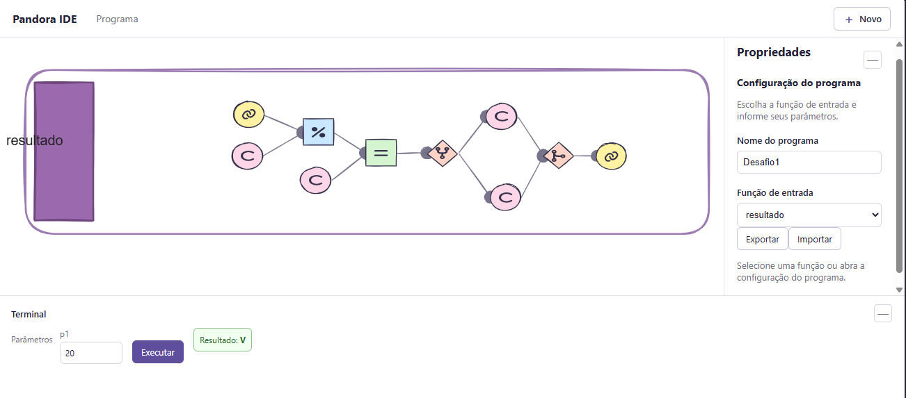

# Padrões em uma Sequência de Resultados
## Sugestão de Grafo Pandora

> O diagrama para o programa Pandora acima pode ser acessado no arquivo [desafio1.json](./desafio1.json).
>
> Para visualizar o grafo, você pode usar a [IDE Web de Pandora](https://example.com). Basta importar o arquivo `desafio1.json` no editor para explorar a estrutura do grafo.

## Explicação
A lógica do programa Pandora para o desafio 1 é baseada na análise da sequência de resultados favoráveis (V) e desfavoráveis (D) ao longo dos dias. A tabela de resultados mostra um padrão alternado, onde os dias ímpares apresentam resultados desfavoráveis (D) e os dias pares apresentam resultados favoráveis (V).

Sendo assim, a função `resultado(n)` pode ser definida da seguinte forma:
- Se `n` for ímpar, o resultado será "D" (desfavorável).
- Se `n` for par, o resultado será "V" (favorável).

A expressão da função é definida por `resultado(n) = "V" se n % 2 == 0, caso contrário "D"`.

No grafo Pandora, os valores `2`, `0`, `D` e `V` são representados como constantes, enquanto a operação de módulo (`%`) é representada como uma operação de nó. A decisão final sobre o resultado é feita com base na avaliação da condição `n % 2 == 0`, que determina se o dia é par ou ímpar.

## Resultado esperado do desafio
O objetivo do desafio é que os participantes consigam identificar o padrão na sequência de resultados e implementem a função `resultado(n)` corretamente, utilizando a lógica descrita acima ou outra abordagem equivalente. A função deve ser capaz de prever o resultado para qualquer valor positivo de `n` sem a necessidade de listar todos os dias anteriores, demonstrando a compreensão do padrão alternado entre dias ímpares e pares.

Com isso, os participantes devem demonstrar sua capacidade de abstração, filtragem de informações relevantes e formulação de hipóteses, conforme as guidelines estabelecidas na pesquisa.