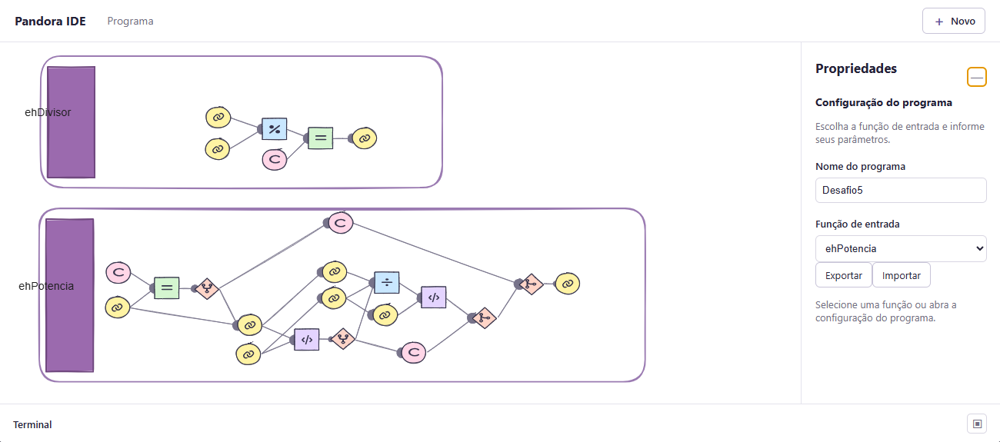

# Generalização de Potências
## Sugestão de Grafo Pandora

> O diagrama para o programa Pandora acima pode ser acessado no arquivo [desafio5.json](./desafio5.json).
>
> Para visualizar o grafo, você pode usar a [IDE Web de Pandora](https://example.com). Basta importar o arquivo `desafio5.json` no editor para explorar a estrutura do grafo.

## Explicação
A partir da função `ehPotenciaDeDois(n)` do desafio anterior, a função `ehPotencia(n, base)` generaliza a verificação para qualquer base maior ou igual a 2. A lógica permanece semelhante, mas agora a função precisa lidar com diferentes bases.

Para isso, é necessário primeiro isolar o que era específico para a base 2 e o que permanece igual para qualquer base:
- **O que era específico para a base 2**: 
    - A verificação de paridade e a divisão por 2.
- **O que permanece igual para qualquer base**:
    - A verificação do caso base `n = 1`, que é uma potência de qualquer base.
    - A divisão repetida do número `n` pela base até que o resultado seja 1 ou um número menor que a base.
    - A verificação de divisibilidade de `n` pela base.

Sendo assim, a função `ehPotencia(n, base)` segue a mesma lógica anterior, substituindo os valores que antes eram constantes = `2` pelo parâmetro `base`. A função auxiliar `ehParPositivo(n)` pode ser adaptada para verificar se `n` é divisível pela base, tornando-se `ehDivisor(n, base)`.

## Resultado esperado do desafio
O objetivo do desafio é que os participantes consigam identificar as partes específicas da função original e generalizá-las para qualquer base maior ou igual a 2, implementando a função `ehPotencia(n, base)` corretamente. A função deve ser capaz de determinar se `n` é uma potência de `base`, demonstrando a compreensão da generalização de funções e da adaptação de algoritmos para diferentes parâmetros.